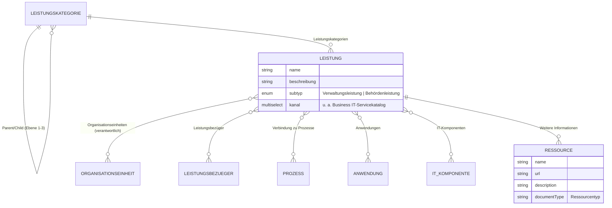
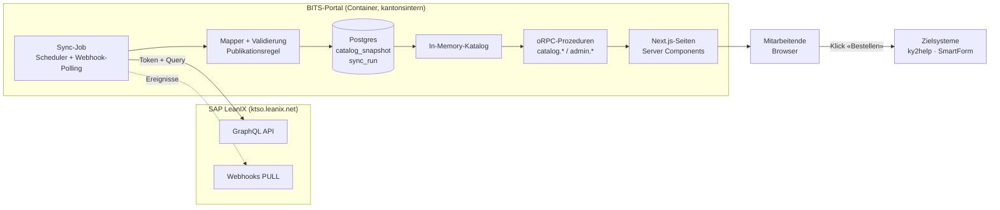

# BITS-Portal – Analyse und Umsetzungsplan

Stand: 10. November 2026 · Status: Discovery ausgewertet, PoC in Arbeit; offene Fragen in [Kapitel 10](#10-offene-fragen--benötigte-informationen)

Kantonsinternes Serviceportal, das die Business-IT-Services des AIO aus SAP LeanIX
(`https://ktso.leanix.net`, Workspace `eamktsoLive`) übersichtlich darstellt und Anfragen
und Bestellungen ohne Medienbruch an das passende Zielsystem weiterleitet.

---

## 1. Ausgangslage

Der ursprüngliche Auftrag ging von Geschäftsfähigkeiten aus (Supporting Capability / IT-Management,
Gruppierung nach Level 3, Leistungen als Kind-Elemente von Level 4). Das Datenmodell in LeanIX hat
sich seither geändert:

| Bisher (Auftrag)                                             | Neu (LeanIX heute)                                                                 |
| ------------------------------------------------------------ | ---------------------------------------------------------------------------------- |
| Geschäftsfähigkeit «Supporting Capability / IT-Management»   | Fact-Sheet-Typ **Leistungskategorie**, Ebene 1–3                                   |
| Gruppierung nach Geschäftsfähigkeit Level 3                  | Gruppierung nach **Leistungskategorie Ebene 2** (Arbeitsplatz-, Backend-, … Services) |
| Service = Geschäftsfähigkeit Level 4                         | Service = **Leistungskategorie Ebene 3** (z. B. «Service eLearning»)               |
| Leistung als Kind-Element von Level 4                        | Fact-Sheet-Typ **Leistung** (Subtyp Verwaltungs- oder Behördenleistung), verknüpft mit Ebene 3 |
| Explizite Freigabe zur Veröffentlichung                      | Feld **Zugangskanal → Kanal** enthält «Business IT-Servicekatalog» (Mehrfachauswahl) |
| Zielsystem pro Service konfigurierbar                        | **Ressource** im Tab «Weitere Informationen» mit bestimmtem Ressourcentyp           |

Das Beispiel «eLearning Inhalte publizieren» bestätigt die Struktur:

```
Leistungskategorie  Ebene 1  Business IT-Servicekatalog
                    Ebene 2  └─ Unterstützungs-Services
                    Ebene 3     └─ Service eLearning
Leistung                           ├─ eLearning Inhalte publizieren   (Verwaltungsleistung)
                                   └─ eLearning Bedarf anmelden
```

---

## 2. Analyse LeanIX

### 2.1 Datenmodell (soweit aus dem Beispiel ersichtlich)



Was im Fact Sheet sonst noch steht (Operativer Aufwand, Digitalisierung, Digitale Reife,
Barriere), ist intern und wird im Portal **nicht** angezeigt (Annahme).

Die **internen Schlüssel** sind in der UI nicht sichtbar. Die Discovery vom 9.11.2026
(Kapitel 11) hat sie bestätigt; sie stehen zentral in `apps/web/lib/leanix/model.ts`:

| Begriff in der UI                  | Interner Schlüssel                                   |
| ---------------------------------- | ---------------------------------------------------- |
| Fact-Sheet-Typ «Leistung»          | `behoerdenLeistungen` (eigener Typ)                  |
| Subtyp                             | Feld `category`: `verwaltungsLeistungen`, `behoerdenLeistungen` |
| Zugangskanal → Kanal               | Feld `kanal` (Mehrfachauswahl)                       |
| Option «Business IT-Servicekatalog» | `Business_IT_Servicekatalog`                        |
| Fact-Sheet-Typ «Leistungskategorie» | `Leistungskategorie` (Ebene über `level`, Hierarchie über `relToParent`) |
| Wurzel «Business IT-Servicekatalog» | ID `f846f11a-5b18-4585-bc74-ef98c056a3c8`           |
| Leistung → Leistungskategorie      | `relbehoerdenLeistungenToLeistungskategorie`         |
| Organisationseinheiten             | Typ `Organisationseinheit`, Relation `relbehoerdenLeistungenToOrganisationseinheit` |
| Leistungsbezüger                   | Typ `UserGroup` (umbenannt), Relation `relbehoerdenLeistungenToUserGroup` |
| Anwendungen / Prozesse             | `relbehoerdenLeistungenToApplication` / `…ToProcess` |
| Leistungsverantwortliche/r         | Abonnement (`subscriptions`) Typ RESPONSIBLE mit Rolle «Leistungsverantwortliche/r» |

**Datenstand (Discovery):** 18 Leistungen, davon 13 im Kanal BITS; 7 davon sind einem Service
(Ebene 3) zugeordnet und erscheinen im Portal. Die übrigen 6 (u. a. «Mobile», «Schulung»,
Testeinträge) haben keine Kategorie und landen im Datenqualitätsbericht. Der Kategorienbaum
umfasst 5 Familien und 29 Services; die meisten Services haben eine Definition und eine
verantwortliche Organisationseinheit.

**Hierarchie bei Leistungen:** Die Folie «Metamodell» sieht Leistungen ohne Hierarchie vor.
In LeanIX gibt es trotzdem Eltern-Kind-Beziehungen (z. B. «Mobile» → «Geschäftliches Mobile
Abo»). Das Portal unterstützt beides: Kind-Leistungen ohne eigene Kategorie erben die Services
der Eltern-Leistung.

**Beschreibungen** sind Markdown (fett, Links, Listen). Sie folgen oft dem Muster
Kurzbeschreibung → «Beschreibung:» → «Gut zu wissen» → «Vorgehen». Das Portal zeigt den
ersten Absatz als Kurzbeschreibung und rendert den Rest sicher (kein HTML).

### 2.2 Publikationsregel

Eine Leistung erscheint im Portal, wenn **alle** Bedingungen erfüllt sind:

1. Fact-Sheet-Typ = Leistung, Status aktiv (nicht archiviert).
2. Feld **Kanal** enthält die Option «Business IT-Servicekatalog» – weitere Kanäle sind erlaubt
   (Mehrfachauswahl, «enthält» statt «ist gleich»).
3. Sie ist mit mindestens einer Leistungskategorie verknüpft, die im Baum unter
   «Business IT-Servicekatalog» (Ebene 1) liegt. Die Wurzel wird über ihre LeanIX-ID konfiguriert,
   nicht über den Namen.

Sonderfälle:

- Leistung im Kanal, aber **ohne Kategorie** im BITS-Baum → nicht im Katalog angezeigt, aber im
  Datenqualitätsbericht (Kapitel 7) gemeldet. Alternativ Rubrik «Weitere Leistungen» – Entscheid offen.
- Leistung mit **mehreren Kategorien** → erscheint bei jedem Service (eine Detailseite, mehrere Einstiege).
- Das Qualitätssiegel eignet sich **nicht** als Kriterium: die fachlich fertigen Leistungen
  (z. B. eLearning) stehen auf «Siegel gebrochen», weil sie nach der Freigabe bearbeitet wurden.
- Leistungskategorien haben kein Kanal-Feld: Alles im Baum unter der Wurzel wird angezeigt,
  auch Services ohne veröffentlichte Leistung (mit Definition und Kontakt).

### 2.3 Abbildung der Anforderungen auf LeanIX

| Anforderung (Auftrag)        | Quelle in LeanIX                                                                 | Status          |
| ---------------------------- | -------------------------------------------------------------------------------- | --------------- |
| Nur freigegebene Services    | Kanal enthält «Business IT-Servicekatalog»                                       | bestätigt       |
| Gruppierung                  | Leistungskategorie Ebene 2 → Ebene 3 → Leistung                                  | bestätigt       |
| Kurzbeschreibung             | Beschreibung der Leistung (erster Absatz als Teaser)                             | Annahme, offene Frage 3 |
| Definition                   | Beschreibung der Leistungskategorie Ebene 3 (Service-Definition)                 | Annahme, offene Frage 3 |
| Verantwortlichkeit           | Relation Organisationseinheiten (Anzeige mit Pfad, z. B. «AIO / Business IT-Services / Service-Management») | Annahme, offene Frage 4 |
| Mögliche nächste Schritte    | Ressourcen bestimmter Typen → Schaltflächen (z. B. «Bestellen» → ky2help, «Anfrage» → SmartForm KAM) | Typen offen, offene Frage 1 |
| Zielsystem pro Service       | URL der Ressource; pro Leistung frei wählbar, ohne Code-Änderung                  | bestätigt (Konzept) |
| Datenbezug aus LeanIX        | GraphQL-API, technischer Benutzer mit Leserechten                                | bestätigt       |

### 2.4 «Weitere Informationen» (Ressourcen)

Der Tab «Weitere Informationen» zeigt die **Ressourcen** eines Fact Sheets. In der API heissen
sie `documents`. Gemäss der API-Spezifikation der Instanz (`/services/pathfinder/v1/api-docs/swagger.json`)
hat eine Ressource diese Felder:

| Feld              | Bedeutung                                                         |
| ----------------- | ----------------------------------------------------------------- |
| `name`            | Anzeigename, z. B. «Bestellen in ky2help»                         |
| `url`             | Ziel-URL (Link) – bei hochgeladenen Dateien leer bzw. Datei-Info  |
| `description`     | Optionaler Text                                                   |
| `documentType`    | **Ressourcentyp** – Grundlage für die Auswahl im Portal           |
| `origin`          | Herkunft (Link, Datei, Integration …)                             |
| `createdAt`, `fileInformation`, `metadata`, `refId` | Zusatzangaben          |

Abfrage per GraphQL direkt mit dem Fact Sheet (`documents { edges { node { … } } }`), also ohne
Zusatz-Requests. Welche Ressourcentypen es gibt, liefert `GET /services/pathfinder/v1/models/factSheetResources`.

Im Portal wird pro Ressourcentyp konfiguriert, was damit passiert. Die Instanz kennt 27
Ressourcentypen; aktuell hat noch keine Leistung eine Ressource. Vorläufige Zuordnung
(`resourceTypeRules` in `apps/web/lib/leanix/model.ts`, fachlich noch zu bestätigen – erwartet
werden vor allem Links):

| Ressourcentyp (Schlüssel)                                   | Darstellung im Portal                          |
| ----------------------------------------------------------- | ---------------------------------------------- |
| `ordering_form` (Bestellformular), `ky2help`                | Primäre Schaltfläche (Bestellen)               |
| `support_ticket`                                            | Schaltfläche «Anfrage stellen»                 |
| `phone_contact`                                             | Kontakt                                        |
| `website`, `Anwendungslink`, `documentation`, `information`, `faq`, `additional_help`, `wiki`, `AIO-Wiki`, `miscellaneous` | Link unter «Weitere Informationen» |
| `policy`, `decision`, `jira`, `roadmap`, `task`, `request` (RFC/RFI), `security`, `certificate`, `image`, `verzeichnis`, `RRB`, `AIO-ServicePortfolio`, `AIO-Lizenzablage`, `Testkonzept` | nicht anzeigen (intern) |

Hat eine Leistung keine Aktion, zeigt das Portal eine konfigurierbare Standard-Aktion
(`CATALOG_FALLBACK_REQUEST_URL`, z. B. Service Desk) und die verantwortliche Stelle.

Hochgeladene **Dateien** sind nur mit LeanIX-Login abrufbar; sie werden im MVP nicht angezeigt
(nur Links). Ressourcen-URLs werden auf `https:` geprüft; optional Allowlist der Zielhosts.

Daneben gibt es in LeanIX die neueren **Vorlagen-Dokumente** (Documents API v2, z. B.
Architekturentscheide). Der technische Benutzer erhält darauf HTTP 403; für das Portal sind nur
die Ressourcen relevant.

### 2.5 API-Zugang (heute an der Instanz geprüft)

| Thema            | Ergebnis                                                                                   |
| ---------------- | ------------------------------------------------------------------------------------------ |
| Erreichbarkeit   | `https://ktso.leanix.net` antwortet; Workspace `eamktsoLive` wird über den Token bestimmt   |
| Token            | `POST /services/mtm/v1/oauth2/token`, Basic-Auth `apitoken:<API-Token>`, `grant_type=client_credentials` → Bearer-Access-Token (zeitlich begrenzt, wird vor Ablauf erneuert) |
| Daten            | GraphQL `POST /services/pathfinder/v1/graphql` (`allFactSheets` mit Facettenfilter, Paging) |
| Modell           | `GET /services/pathfinder/v1/models/dataModel`, `…/models/factSheetResources`, `…/models/languages/de` |
| Änderungsereignisse | Webhooks-API mit **PULL-Subscriptions** (`/services/webhooks/v1/subscriptions/{id}/events`): das Portal holt Ereignisse ab, LeanIX muss das kantonale Netz nicht erreichen |
| Benutzer         | Technischer Benutzer, heute mit Workspace-Rolle **Member**. Empfehlung: auf **Viewer** (nur lesen) reduzieren. Token nur serverseitig, nie im Browser |

---

## 3. Bordmittel LeanIX oder eigenes Portal?

| Variante | Beschreibung | Beurteilung |
| -------- | ------------ | ----------- |
| A. LeanIX-Inventar, gespeicherte Ansichten, Dashboards | Gefilterte Inventarliste nach Kanal | Jede Person braucht einen LeanIX-Zugang und landet in einem EA-Werkzeug. Keine serviceorientierte Darstellung, keine Bestell-Schaltflächen. **Nicht geeignet.** |
| B. LeanIX Custom Report (Reporting-Framework) | Eigene HTML/JS-Ansicht innerhalb von LeanIX, Daten live per GraphQL | Darstellung frei gestaltbar, Daten direkt. Aber: weiterhin LeanIX-Login für alle Mitarbeitenden (Lizenz- und Rollout-Frage), im LeanIX-Rahmen eingebettet, kein Caching bei Ausfall, CD nur eingeschränkt umsetzbar. **Möglich als Vorschau für Datenpflegende, nicht als Portal für alle.** |
| C. Eigenes Webportal, LeanIX als führendes System | Next.js-Portal (dev-template), liest per API, speichert einen Snapshot | Für alle Mitarbeitenden ohne LeanIX-Konto, CD-konform, ausfallsicher, Zielsysteme als Links. Zusätzlicher Betrieb (Container, Datenbank). **Empfohlen.** |

**Empfehlung: Variante C.** LeanIX bleibt einziges Pflegesystem; das Portal liest nur und
speichert nichts zurück. Variante B kann später ergänzend als Pflegeansicht dienen.

---

## 4. Zielarchitektur



### 4.1 Caching und Ausfallsicherheit

Grundsatz: **Keine Benutzeranfrage geht an LeanIX.** Das Portal liefert immer aus dem letzten
gültigen Snapshot.

1. **Sync** – Der Sync-Job lädt Leistungen (im Kanal) und Leistungskategorien (BITS-Baum) mit
   wenigen paginierten GraphQL-Abfragen, wendet die Publikationsregel an und erzeugt einen
   normalisierten Katalog (JSON, versioniertes Schema, mit Zod validiert).
2. **Plausibilisierung** – Ein neuer Snapshot wird nur übernommen, wenn er gültig ist und nicht
   unplausibel schrumpft (z. B. weniger als 50 % der Leistungen des Vorgängers → nicht übernehmen,
   Warnung im Admin-Bereich). Schützt vor Teilantworten und versehentlichem Massen-Entfernen.
3. **Persistenz** – Snapshot in Postgres (`catalog_snapshot`, die letzten N Versionen); dazu
   Protokoll jedes Laufs (`sync_run`: Auslöser, Dauer, Anzahl, Fehler).
4. **Auslieferung** – Beim Start wird der neueste Snapshot in den Speicher geladen; Seiten lesen
   nur daraus. Fällt LeanIX aus, läuft das Portal unverändert weiter. Fusszeile: «Stand: …»;
   ab einem Schwellwert (z. B. 24 h ohne erfolgreichen Sync) Hinweis für Admins.
5. **Aktualisierung** –
   - MVP: Intervall (z. B. alle 15 Minuten) + Schaltfläche «Jetzt synchronisieren» im Admin-Bereich.
   - Ausbau: Webhook-PULL-Subscription auf Fact-Sheet-Änderungen; bei relevanten Ereignissen
     (entprellt) Voll-Sync → Änderungen in LeanIX sind nach 1–2 Minuten sichtbar.
   - Der Voll-Sync bleibt in jedem Fall (wenige Requests, robust, kein Delta-Abgleich nötig).
6. **Mehrere Instanzen** – Postgres-Advisory-Lock, damit nur eine Instanz synchronisiert.
7. **Erststart ohne Snapshot und ohne LeanIX** – Seite «Katalog vorübergehend nicht verfügbar».
   Optional ein exportierter Snapshot als Datei im Volume als zweite Rückfallebene.

### 4.2 Konfiguration

Alles, was vom LeanIX-Modell abhängt, liegt in einer typisierten Konfiguration (Zod-validiert,
`apps/web/lib/leanix/config.ts` + Umgebungsvariablen), nicht im Code verstreut:

```ts
// Werte nach Discovery eintragen – hier nur Platzhalter
export const leanixMapping = {
  leistungType: "<FactSheetType Leistung>",
  kategorieType: "<FactSheetType Leistungskategorie>",
  channelField: "<Feldschlüssel Kanal>",
  channelOption: "<Optionsschlüssel Business IT-Servicekatalog>",
  rootCategoryId: "<LeanIX-ID der Ebene-1-Kategorie>",
  relations: {
    kategorie: "<rel… Leistung → Leistungskategorie>",
    organisation: "<rel… Leistung → Organisation>",
    bezueger: "<rel… Leistung → Leistungsbezüger>",
  },
  resourceTypes: {
    "<typ-bestellung>": { role: "action", label: "Bestellen", primary: true },
    "<typ-anfrage>": { role: "action", label: "Anfrage stellen" },
    "<typ-doku>": { role: "link" },
  },
} as const
```

Umgebungsvariablen (nur serverseitig): `LEANIX_BASE_URL`, `LEANIX_API_TOKEN`,
`CATALOG_SYNC_INTERVAL_MINUTES`, `CATALOG_MIN_RATIO`.

### 4.3 Sicherheit

- Technischer Benutzer nur mit Leserechten; Token als Secret, Ablaufdatum gesetzt, Erneuerung im
  Betriebshandbuch.
- Beschreibungen aus LeanIX werden als Text gerendert (Zeilenumbrüche erhalten), kein HTML.
- Links nur `https:`; externe Links mit `rel="noopener"`.
- Katalog ohne Anmeldung im Intranet; Admin-Bereich mit Anmeldung (SAML-SSO, im PoC zusätzlich Passwort).

---

## 5. Techstack und Projektstruktur

Vorgabe ist [Laeri/dev-template](https://github.com/Laeri/dev-template) (fix): pnpm + Turborepo,
Next.js 16 (App Router), Tailwind CSS v4, shadcn/ui, oRPC (contract-first), TanStack Query,
Zod 4, better-auth, Drizzle + Postgres, Docker.

### 5.1 Was übernommen, angepasst, entfernt wird

| Bereich                     | Vorgehen                                                                 |
| --------------------------- | ------------------------------------------------------------------------ |
| Monorepo, oRPC, Zod, Drizzle, Docker | unverändert übernehmen                                           |
| better-auth (Admin-Login)   | übernehmen; SAML mit kantonalem IdP (offene Frage 7) plus Passwort-Login           |
| Feature `tasks`, Startseiteninhalt `overview` | entfernen (Beispielcode)                               |
| E-Mail/2FA                  | E-Mail: entfernt (kein Passwort-Reset, keine Bestätigungsmails), 2FA bleibt |
| Theme (`app/globals.css`)   | durch CD-Tokens ersetzen (Kapitel 6.2)                                   |
| Neu: Sync-Scheduler         | `apps/web/instrumentation.ts` (Node-Runtime) + Advisory-Lock             |
| Neu: Tests                  | Vitest für Mapper und Publikationsregel mit Fixtures aus der Discovery   |

Die Regeln aus `AGENTS.md` des Templates gelten: nur `/rpc` und `/api/auth` als Route-Handler,
keine Server Actions, Geschäftslogik in oRPC-Prozeduren, Server Components lesen über einen
serverseitigen oRPC-Router-Client. Vor dem Codieren die Next.js-16-Doku in
`node_modules/next/dist/docs/` lesen.

### 5.2 Struktur

```
apps/web/
  app/
    page.tsx                         Start: Suche + 5 Service-Familien
    kategorie/[slug]/page.tsx        Ebene 2: Services der Familie
    service/[slug]/page.tsx          Ebene 3: Definition + Leistungen
    leistung/[slug]/page.tsx         Leistung: Details + nächste Schritte
    (app)/admin/catalog/page.tsx     Sync-Status, manueller Sync, Datenqualität
  features/
    catalog/
      components/                    Kacheln, Service-Liste, Leistungskarte, Aktionen, Suche
      server/router.ts               catalog.* (liest In-Memory-Katalog)
      server/store.ts                Snapshot laden/halten
    catalog-sync/
      server/router.ts               admin.catalog.* (Status, Sync auslösen, Qualität)
      server/sync.ts                 Ablauf, Plausibilisierung, Persistenz
      server/mapper.ts               LeanIX-Rohdaten → Katalog (reine Funktionen, getestet)
      server/queries.ts              GraphQL-Abfragen
  lib/leanix/
    client.ts                        Token-Handling, GraphQL-Aufruf, Retry/Timeout
    config.ts                        Mapping (Kapitel 4.2)
  db/schema/catalog.ts               catalog_snapshot, sync_run
  instrumentation.ts                 Scheduler-Start
packages/api/src/
  contracts/catalog.ts               catalog.overview/category/service/leistung/search
  schemas/catalog.ts                 Katalog-Schemas (auch Snapshot-Validierung)
```

### 5.3 Katalog-Schema (Entwurf)

```ts
Catalog {
  generatedAt: Date; source: { host: string; workspace: string }
  families: Family[]        // Ebene 2: id, name, slug, description, order, serviceIds
  services: Service[]       // Ebene 3: id, name, slug, definition, familyId, responsible, links, leistungIds
  leistungen: Leistung[]    // id, name, slug, subtype, summary, description, channels,
                            // responsible: OrgUnit[], audiences: string[], applications: string[],
                            // serviceIds, actions: Action[], links: Link[], updatedAt
  issues: QualityIssue[]    // für den Admin-Bericht
}
```

Slugs aus Name + kurzer ID (stabil bei gleichen Namen); bei Umbenennung Weiterleitung über die ID.

---

## 6. Benutzerführung und Design

### 6.1 Seiten

| Seite        | Inhalt                                                                                   |
| ------------ | ---------------------------------------------------------------------------------------- |
| Start        | Suchfeld «Was benötigen Sie?»; fünf Service-Familien als Kacheln mit Anzahl Services      |
| Familie (Ebene 2) | Liste der Services mit Definition (gekürzt)                                         |
| Service (Ebene 3) | Definition, verantwortliche Stelle, Leistungen als Karten: Kurzbeschreibung, Subtyp, Schaltflächen «Bestellen» / «Anfrage stellen» |
| Leistung     | Volle Beschreibung, Verantwortlich, Leistungsbezüger, Anwendungen, nächste Schritte, weitere Informationen, «Stand: …» |
| Suche        | Volltext über Name, Beschreibung, Service, Anwendungen; Filter Subtyp und Leistungsbezüger; clientseitig (kleine Datenmenge) |

Brotkrumen auf allen Seiten (Start › Familie › Service › Leistung). Leistungen ohne
Aktions-Ressource zeigen einen Standard-Kontakt (z. B. Service Desk) – offene Frage 2.

### 6.2 Corporate Design ([CD-Manual](https://github.com/ktsobus/CD-Manual-Kanton-Solothurn))

| Vorgabe                                  | Umsetzung im Portal                                                          |
| ---------------------------------------- | ---------------------------------------------------------------------------- |
| Solothurner Rot `#CC0000`, Schwarz, Weiss | Akzent für Schaltflächen und Titelmarke; Kontrast auf Weiss 5,9:1 (WCAG AA) |
| Grafik-Grau `#646B76`, Schwarz `#333333` | Sekundärtext (5,4:1 auf Weiss), Fliesstext                                   |
| Tonwerte (z. B. DodgerBlue4 8 % `#ECF1F6`) | Flächen für Kacheln und Hinweise                                           |
| Frutiger LT Std 55/56/75/76              | PoC: freie Schrift Source Sans 3 (humanistisch, ähnlicher Charakter), nur 400/700 + kursiv; Frutiger-Webfont später mit Lizenz |
| Keine Verläufe, keine Schatten           | Flache Flächen, Haarlinien; shadcn-Schatten im Theme entfernen               |
| Rotes Quadrat beim Seitentitel           | Titelkomponente mit rotem Quadrat                                            |
| Linksbündig, max. ~70 Zeichen            | `max-w-[70ch]` für Fliesstext, nichts zentriert                              |
| « », –, …                                | UI-Texte entsprechend; Listen mit Halbgeviertstrich                          |
| Logo nur Originaldatei                   | SVG beim Kompetenzzentrum für Publikationsmedien beziehen; nicht nachbauen   |
| Absender in Black Italic                 | Fusszeile «Amt für Informatik und Organisation»                               |

Barrierefreiheit nach eCH-0059 (WCAG 2.1 AA): Tastaturbedienung, Fokusrahmen, semantische
Überschriften, Alternativtexte.

---

## 7. Datenqualitätsbericht (Admin)

Der Sync erzeugt bei jedem Lauf eine Liste von Auffälligkeiten, im Admin-Bereich mit Link direkt
auf das Fact Sheet in LeanIX:

- Leistung im Kanal, aber ohne Kategorie im BITS-Baum
- Leistung ohne Beschreibung oder ohne verantwortliche Organisationseinheit
- Leistung ohne Aktions-Ressource (kein «nächster Schritt»)
- Ressource mit ungültiger URL oder nicht konfiguriertem Typ
- Kategorie Ebene 3 ohne veröffentlichte Leistung (leerer Service)

So kann das Service-Management die Daten in LeanIX gezielt nachpflegen.

---

## 8. Umsetzungsplan

| Phase | Inhalt | Ergebnis |
| ----- | ------ | -------- |
| 0 Klärung & Discovery | Technischen Benutzer bestätigen, Discovery-Skript ausführen, offene Fragen klären | Festgelegtes Mapping (Kapitel 4.2), Fixtures für Tests |
| 1 Grundgerüst | Repo aus dev-template, Beispielcode entfernen, CD-Theme, Layout (Kopf, Fuss, Brotkrumen, Titelkomponente) | Lauffähiges, leeres Portal im CD |
| 2 LeanIX-Anbindung | Token-Client, Queries, Mapper + Tests, Snapshot-Tabellen, Sync mit Plausibilisierung, Scheduler | Katalog wird aus LeanIX gefüllt und gecacht |
| 3 Portal-UI | Start, Familie, Service, Leistung, Suche, Aktionen/Links | Nutzbares Portal |
| 4 Admin | Login, Sync-Status, manueller Sync, Datenqualitätsbericht | Betrieb und Datenpflege unterstützt |
| 5 Betrieb | Docker-Image, Deployment, Health-Check, Monitoring, Betriebshandbuch (Token-Rotation) | Produktiv |
| 6 Ausbau (optional) | Webhook-PULL, Deep-Links mit Vorbelegung, Custom Report als Pflegevorschau | Schnellere Aktualisierung |

Beteiligte Teams (Auftragstyp «mehrere Teams»):

| Team / Rolle                          | Liefert                                                          |
| ------------------------------------- | ---------------------------------------------------------------- |
| LeanIX-Administration (EA)            | Technischer Benutzer, Ressourcentypen, Modellauskunft            |
| Service-Management BITS               | Datenpflege (Kanal, Kategorien, Ressourcen), fachliche Abnahme   |
| ky2help- / SmartForm-Verantwortliche  | Ziel-URLs, ggf. Parameter für Vorbelegung                        |
| Betrieb / Plattform                   | Hosting, Postgres, Proxy-Freigabe zu `ktso.leanix.net`, DNS      |
| Kompetenzzentrum Publikationsmedien   | Logo-Dateien, Frutiger-Webfont-Lizenz                            |

---

## 9. Risiken

| Risiko | Massnahme |
| ------ | --------- |
| LeanIX-Modell ändert sich erneut | Mapping in Konfiguration; Sync bricht bei unbekannter Struktur ab, alter Snapshot bleibt |
| LeanIX nicht erreichbar | Snapshot-Cache, Plausibilisierung, Statusanzeige |
| Unvollständige Daten in LeanIX | Datenqualitätsbericht; Platzhaltertexte statt leerer Felder |
| Token läuft ab | Ablauf überwachen (Sync-Fehler → Admin-Hinweis), Rotation im Betriebshandbuch |
| Zielsysteme ändern URLs | URLs nur in LeanIX gepflegt, keine Duplikate im Portal |
| API-Grenzen (Rate Limits) | Sync mit wenigen paginierten Abfragen, nie pro Seitenaufruf |

---

## 10. Offene Fragen / benötigte Informationen

### Geklärt (10.11.2026)

| Thema | Antwort / Entscheid |
| ----- | ------------------- |
| API-Zugang | Discovery erfolgreich; Token-Rolle heute *Member* → auf *Viewer* reduzieren empfohlen |
| Ressourcentypen | Noch offen, voraussichtlich vor allem Links → vorläufige Zuordnung (Kapitel 2.4), jederzeit änderbar |
| Hosting | Interner Server (Docker-Image + Postgres) |
| Zugriff | Katalog ohne Anmeldung; Admin mit SSO (SAML) wenn möglich, für den PoC zusätzlich einfache Anmeldung (Passwort) |
| Schrift | Gratis-Schrift statt Frutiger: **Source Sans 3** (SIL OFL), lokal eingebunden, ohne Google-Fonts-Abruf |
| Logo | Online beschaffen, wenn möglich über eine API (siehe `docs/branding.md`); muss im PoC nicht final sein |
| Gruppierung | Gemäss Folien: Leistungskategorie Ebene 2 = Familie, Ebene 3 = Service, darunter Leistungen |
| Freigabe | Kanal reicht; Qualitätssiegel ist kein Kriterium (Kapitel 2.2) |

### Noch offen

1. **Ressourcentypen** fachlich festlegen: Welche Typen werden Schaltflächen (Bestellen, Anfrage),
   welche Links? Mehrere Aktionen pro Leistung erlaubt?
2. **Standard-Aktion** ohne erfasste Ressource: Welche URL (Service Desk, ky2help-Startseite)?
3. **Kurzbeschreibung und Definition**: Annahme im PoC – erster Absatz der Leistungsbeschreibung
   = Kurzbeschreibung, Beschreibung der Kategorie Ebene 3 = Service-Definition. Bestätigen?
4. **Verantwortlichkeit**: Im PoC werden alle verknüpften Organisationseinheiten angezeigt.
   Personen (Leistungsverantwortliche/r) sind vorbereitet, aber ausgeschaltet
   (`CATALOG_SHOW_PERSONS`). Sollen sie sichtbar sein?
5. **Leistungen ohne Kategorie** (heute 6, u. a. «Mobile», «Schulung»): in LeanIX zuordnen oder
   im Portal unter «Weitere Leistungen» zeigen? Im PoC: ausgeblendet, im Datenqualitätsbericht.
6. **Hosting-Details**: Proxy für ausgehenden Verkehr zu `ktso.leanix.net`? Postgres vorhanden
   oder als Container? URL des Portals, Einbindung ins Intranet?
7. **SSO**: Welcher Identity Provider (z. B. Entra ID) und wer richtet die SAML-App ein?
8. **ky2help / SmartForm**: Lassen sich Formulare per URL-Parameter vorbelegen (Leistungsname/-ID)?
9. **Sprachen**: Nur Deutsch?

---

## 11. Discovery-Skript

`scripts/leanix-discovery.mjs` liest Datenmodell und Beispieldaten aus, nur lesend, ohne
Abhängigkeiten (Node 22+). Token und Access-Token werden weder gespeichert noch ausgegeben.

```bash
LEANIX_API_TOKEN=<token> node scripts/leanix-discovery.mjs
```

Ergebnis im Ordner `leanix-discovery/`:

| Datei                               | Inhalt                                                         |
| ----------------------------------- | -------------------------------------------------------------- |
| `summary.md`                        | Zusammenfassung: Typen, Kanal-Schlüssel, Relationen, Ressourcentypen, Anzahl Leistungen, Kategorienbaum |
| `data-model.json`, `meta-model.json`, `view-model.json`, `language-de.json` | Modell und deutsche Bezeichnungen |
| `fact-sheet-resources-model.json`   | Konfigurierte Ressourcentypen                                  |
| `graphql-schema-types.json`         | GraphQL-Schema (für typisierte Abfragen)                       |
| `sample-fact-sheet.json`            | Vollständige Beispiel-Leistung inkl. Relationen und Ressourcen |
| `all-leistungen.json`, `all-leistungskategorien.json` | Alle Leistungen (flach) und Kategorien       |
| `documents-v2-*.json`               | Vorlagen-Dokumente (zur Abgrenzung)                            |

Der Ordner enthält Inhalte aus LeanIX (Namen, Organisationseinheiten). Vor der Weitergabe kurz
prüfen; `leanix-discovery/` ist in `.gitignore` und wird nicht eingecheckt.

Das Skript wurde gegen einen lokalen Mock getestet, noch nicht gegen die echte Instanz.
